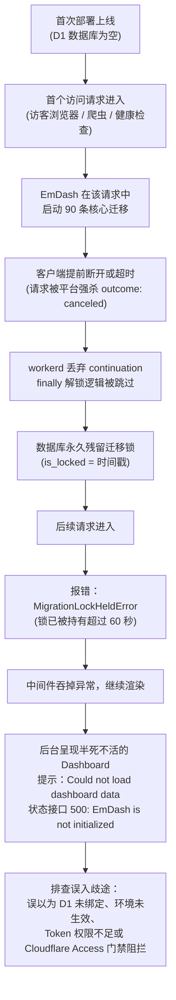
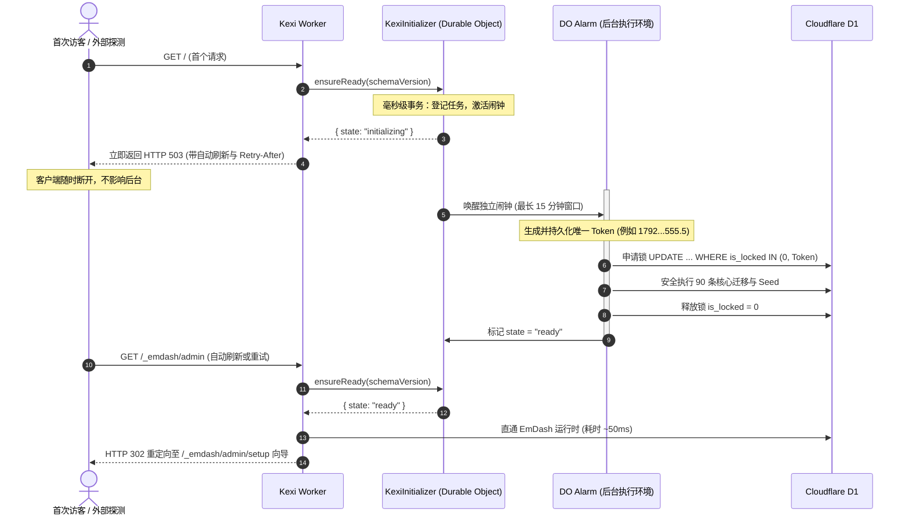

# EmDash 首次运行时初始化死锁与上游架构缺陷深度复盘

> **文档定位**：本文档记录 Kexi 主题在 Cloudflare Workers 上部署时发现的严重上游（EmDash）初始化死锁缺陷、排查过程中的误判陷阱、根因机理剖析及 Kexi 的彻底治本方案。供后续维护、版本升级和技术审计备查，避免未来重蹈覆辙。

---

## 1. 现象：极具欺骗性的「假死」与「死锁」

在全新的 Cloudflare 账号中 Fork 或首次部署 EmDash 站点时，往往会遭遇以下一系列极具误导性的连环故障：



### 生产现场的核心证据

1. **迁移半途而废**：
   数据库表 `_emdash_migrations` 仅记录了部分迁移（如 34 条或 40 条，总数为 90 条），停在 `035_bounded_404_log` 或 `041_content_locale_list_index`。内容集合数为 0，用户数为 0，种子标记未写入。
2. **迁移锁永久被占**：
   查询 `_emdash_migrations_lock` 表，`is_locked` 字段停留在首次请求执行时的时间戳：
   ```sql
   SELECT * FROM _emdash_migrations_lock;
   -- id: "migration_lock", is_locked: 1792129385158
   ```
3. **Cron 定时任务持续报警**：
   每分钟执行一次的后台维护任务抛出异常：
   ```text
   MigrationLockHeldError: The migration lock has been held since 2026-10-16T05:43:05.158Z (lock 1792129385158).
   A migration may still be running; if none is, check the database and release the lock.
   ```
4. **重新部署毫无用处**：
   多次重新构建并重新 `wrangler deploy`，锁依然在 D1 数据库中稳如泰山。
5. **极其误导的前端反馈**：
   页面不是直接返回 500，而是能吐出完整的后台 HTML 框架，但局部组件报错；接口返回 `EmDash is not initialized`。

---

## 2. 根因剖析：四大致命架构错配

这个 BUG 并非简单的编码手误，而是上游框架在架构设计时产生的多处致命错配：

### 错配一：将传统常驻 Node.js 思维硬套进 Serverless 边缘环境

- **传统服务器（VPS / 容器）**：Node.js 进程长期存活。首次启动时跑两分钟迁移没有任何问题，即便没有访客，服务自己也能把建表任务跑完。
- **边缘云函数（Cloudflare Workers）**：实例是事件驱动的。普通 HTTP 请求受平台严格的执行生命周期管控：
  - 访客如果看到白屏时间稍长随手关掉标签页，或者爬虫、CDN 探测在发完握手后掐断连接，平台会立刻将该请求标记为取消（`outcome: "canceled"`）。
  - 即使框架使用 `ctx.waitUntil()` 尝试在请求结束后继续跑，Cloudflare 也只给最多约 **30 秒**的宽限期。
  - **实测数据**：在 Cloudflare D1 边缘数据库上，完整执行 90 条核心迁移与初始模型构建需要数十次到数百次物理 SQL 往返，稳态耗时约 **130 秒**。
- **结论**：**把一个耗时两分钟的重型事务放在首个普通的访客请求里执行，从架构模型上注定失败。**

### 错配二：以为 JavaScript 的 `try ... finally` 永远保底

上游在编写加锁逻辑时，采用了典型的局部防御思维：
```typescript
await acquireMigrationLock();
try {
  await runAllMigrations();
} finally {
  await releaseMigrationLock(); // 开发者以为无论如何都会释放
}
```
**但在 Cloudflare workerd 底层**：
- 当一个请求被平台取消（`canceled`）或后台时间配额耗尽被强杀时，**workerd 会直接终止该执行上下文，事件循环的微任务队列和 continuation 会被整体抛弃**。
- `finally` 代码块**根本不会得到执行机会**！
- 结果：锁已经写入了远端 D1，迁移刚跑到一半进程瞬间蒸发，远端数据库留下死锁。

### 错配三：粗暴的锁超时机制，将设计缺陷转嫁给人工 CLI

由于 SQLite 和 D1 没有原生跨进程/跨 Worker 的 Advisory Lock，上游采用在 `_emdash_migrations_lock` 表中记录加锁时间戳的方案。

然而其锁竞争策略极为僵化：
- 其他 Worker 实例遇到有锁，最多轮询等待 10 秒；
- **如果锁的时间戳超过 60 秒，系统直接判定为“可能是崩溃残留”，但为了安全，系统绝不允许自动恢复或抢占，必须抛出 `MigrationLockHeldError` 拒绝一切请求**；
- 官方甚至在错误信息中直接附带文档链接，要求运维人员手动登录服务器，使用 CLI 命令：
  ```bash
  pnpm emdash migrate --release-lock
  # 或上游 PR #4068 新增的
  pnpm emdash migrate --take-over-lock <timestamp>
  ```
- **荒谬之处**：一个号称面向现代 Serverless 的一键式开源系统，却把日常可能发生的网络抖动和请求中断，变成必须由人工核对指纹、运行 CLI 甚至执行 SQL 才能解开的运维事故。

### 错配四：中间件吞异常，掩盖真实故障根因

最令开发者抓狂的是其错误处理机制的混乱：
1. 当首次请求因锁死抛出 `MigrationLockHeldError` 或 `ConcurrentMigrationTimeoutError` 后；
2. EmDash 的 Astro 中间件在捕获到部分启动错误时，**竟然直接把错误吞掉，允许请求继续往下走**；
3. 下游的 Setup 中间件因为读取不到 `locals.emdash.db`，将其判定为“开发者未配置数据库”，从而跳过初始化向导的重定向；
4. 后台页面继续渲染，吐出一个半成品的 Dashboard 外壳，上面写着 `Could not load dashboard data`；
5. 这让所有人第一时间都会怀疑是自己的 `wrangler.jsonc` 绑定名字写错、环境变量配错、或是外层 Cloudflare Access 拦截，彻底掩盖了底层数据库正被死锁卡住的事实。

---

## 3. 曾经踩过的应急绕过陷阱（勿重犯）

在排查阶段，我们曾通过以下方式暂时恢复了生产：
1. `astro.config.mjs` 中设置 `migrations: { runtime: "check", dev: "auto" }`；
2. 编写 `scripts/deploy.mjs`，在每次部署前通过 CLI 调用 `emdash migrate` 强制预迁移，线上只做检查；
3. 需要非交互式配置 `EMDASH_TARGET_FINGERPRINT`，以及具有 D1 权限的 `CLOUDFLARE_API_TOKEN`。

### 为什么必须废弃这套方案？
- **破坏了 Fork 开源主题的核心价值**：新人 Fork 项目后，期望的是在 Cloudflare 上点几次鼠标或者执行一次 `pnpm deploy` 就能用，绝不应该被逼着去控制台找数据库 UUID、计算目标指纹、生成特定权限的 API Token。
- **它只是掩盖了问题，而不是解决了问题**：它只是把“运行时初始化”剥离掉，强加给了部署阶段的运维人员，没有从架构上治愈边缘函数的执行模型错配。

---

## 4. Kexi 的彻底治本方案

Kexi 通过全新的初始化架构，既彻底斩断了导致死锁的根因，又完整保留了新人 Fork 后的**零手动、全自动部署体验**。决定见 [ADR 0006](./adr/0006-durable-alarm-initialization.md)。



### 治本方案四大核心机制

1. **执行与访客彻底解耦（Durable Object 闹钟）**：
   - 访客请求只负责在持久化事务中登记任务并唤醒闹钟；
   - 访客请求在 **100 毫秒**内立刻返回 503 友好提示页；无论访客如何断开、爬虫如何中止，都不会触发平台的 `canceled` 强杀逻辑。
2. **长达 15 分钟的稳定执行窗口**：
   - Durable Object 闹钟（Alarm）不受请求生命周期限制，拥有长达 15 分钟的充裕时间在后台稳定跑完 90 条迁移；
   - 遇到代码更新或实例重启时，平台保证至少执行一次（At-least-once），自动重试。
3. **带专属标记的安全所有权恢复（Resumable Ownership）**：
   - 任务启动前，协调器先在本地存储持久化一个非整数微秒标记（如 `floor(now) + 0.5`），与普通 CLI 的整数时间戳天然区分；
   - 申请与恢复锁的 SQL 为：
     ```sql
     UPDATE "_emdash_migrations_lock"
     SET "is_locked" = ?
     WHERE "id" = ? AND "is_locked" IN (0, ?)
     ```
   - 即使任务发生意外重试，它**只能恢复自己持久化过的 Token**，绝不凭时间戳偷抢别人的锁，也绝不会让锁永久锁死。
4. **全自动免配置部署（真正的零门槛）**：
   - `wrangler.jsonc` 仅声明名称（D1 `kexi`、R2 `kexi-media`、KV `SESSION`、DO `INITIALIZER`）；
   - 初次部署时 Wrangler 全自动创建所有资源，用户直接访问 `/_emdash/admin` 创建管理员，无需任何手工命令。

---

## 5. 给后续维护者的重要戒律

1. **切勿把初始化逻辑移回 HTTP 请求中**：
   无论上游如何宣称优化了冷启动，只要是在普通的 HTTP 请求内跑重型数据建表，就永远无法抵御边缘云函数平台的中途强杀。
2. **切勿以为 `try ... finally` 万无一失**：
   在 Serverless 环境下，外部连接断开或超时强杀时，Promise continuation 与 `finally` 均可能被丢弃。所有关键状态（如锁、进度）必须有外部持久化保障。
3. **切勿盲信 HTTP 200**：
   中间件吞错误是极难排查的坏味道。验证站点健康必须核对：
   - 迁移总数是否与已声明迁移数完全吻合（当前为 90）；
   - 迁移锁 `is_locked` 是否归零；
   - `/_emdash/api/setup/status` 是否返回 `needsSetup: true` 并带有内容模型。
4. **升级 EmDash 版本的核查步骤**：
   若未来升级 `emdash` 或 `@emdash-cms/cloudflare`，必须运行 `pnpm test:init` 与全新空库回归测试，确认上游未引入新的前置假设或破坏 Kexi 的 D1 运行时适配器。
